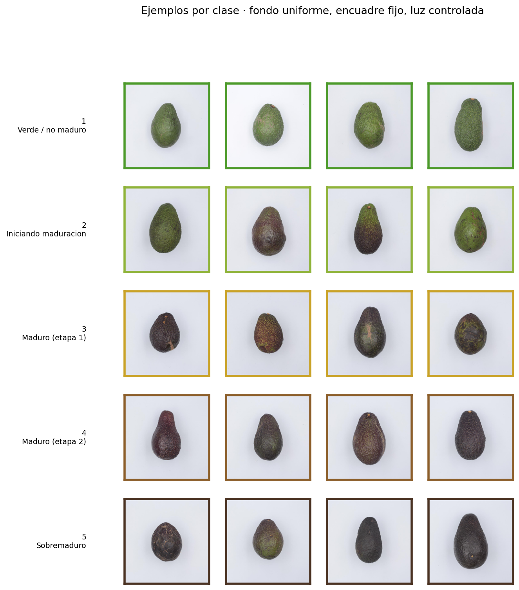

# Clasificación del estado de madurez de paltas Hass

### Demostración local en varios computadores Windows

El paquete `dist/PaltasDemo.zip` contiene la app y los parámetros ya entrenados.
En cada computador: extraer todo el ZIP, ejecutar `INSTALAR.cmd` una vez y luego
`INICIAR.cmd`. Abre una app local con **Cámara en vivo**, carga de **Foto**, madurez
y mapa de calor descargable. CPU funciona sin GPU; NVIDIA es opcional.
La instalación inicial necesita Internet, pero la inferencia no necesita dataset,
reentrenamiento ni conexión a un servicio externo.

Instrucciones completas: [`app/LEEME-local.md`](app/LEEME-local.md).
Para reconstruir el ZIP en el equipo que tiene el checkpoint:

```powershell
python scripts/empaquetar_app.py
```

Los pesos se incluyen en el ZIP, aunque no se versionan en Git. Copiar solo el
repositorio de GitHub no reemplaza el paquete completo de demostración.

### App: foto, cámara y mapa de calor

Con un checkpoint entrenado en `checkpoints/`:

```powershell
& "$env:LOCALAPPDATA/paltas-gpu/.venv/Scripts/python.exe" app/gradio_app.py
```

Abre `http://localhost:7860`. La pestaña **Foto** recibe una imagen y devuelve el
estado de madurez de 1 a 5, las probabilidades y un mapa de calor descargable en
PNG. La pestaña **Cámara en vivo** envía imágenes aproximadamente cada segundo
mientras la cámara está activa; la predicción se calcula en la GPU del PC.
El envío termina al detener la cámara. Cada imagen usa una petición HTTP
independiente, compatible con túneles temporales sin soporte SSE.

Para abrirla desde el teléfono en la misma red, agrega `--host 0.0.0.0` y abre
`http://IP_DEL_PC:7860`. Para usar la cámara en vivo desde el teléfono hace falta
HTTPS y permiso de cámara del navegador. `--share` genera un enlace HTTPS
temporal accesible desde Internet: quien tenga ese enlace podrá usar la app.
El computador debe permanecer encendido. No se cambia el firewall automáticamente.

Si Windows impide ejecutar el cliente de `--share`, se puede usar un túnel
temporal de Cloudflare previamente autorizado, con `cloudflared` instalado:

```powershell
cloudflared tunnel --url http://localhost:7860 --protocol http2
```

El enlace `trycloudflare.com` que imprime es público y dura mientras el túnel
permanezca abierto; las fotos pasan por Cloudflare hacia el PC. La app usa
peticiones HTTP por imagen para evitar depender de SSE en este modo.

En ResNet se usa **Grad-CAM para la clase elegida**. En ViT, **attention rollout**
muestra atención entre parches y no es específico de la clase. El mapa se alinea
con el recorte que vio la red; no segmenta la palta ni prueba una causa física.
Las fotos de teléfono siguen siendo un dominio distinto al dataset de laboratorio.

El entrenamiento nuevo para esta app usa el nombre `resnet50_app`; conserva los
resultados del informe y elige el checkpoint por QWK de validación:

```powershell
& "$env:LOCALAPPDATA/paltas-gpu/.venv/Scripts/python.exe" scripts/train.py --config configs/resnet50.yaml --name resnet50_app --num-workers 4
```

La corrida nueva eligió la época 8 por validación. En el test del dataset obtuvo
74,6 % de accuracy exacta y QWK 0,9337 (`reports/metrics/resnet50_app_test.json`).
Esto no mide desempeño en fotos de teléfono. Los cinco ejemplos exportados están
en `reports/figures/mapas_app/`, con sus predicciones en
`reports/metrics/resnet50_app_mapas.json`. El checkpoint queda localmente en
`checkpoints/resnet50_app.pt`; los pesos no se versionan en Git.

### Tarea E en Windows con NVIDIA RTX 50

Preparar un entorno independiente (Python 3.11, PyTorch 2.7.1 + CUDA 12.8):

```powershell
powershell -ExecutionPolicy Bypass -File scripts/setup_gpu.ps1
powershell -ExecutionPolicy Bypass -File scripts/run_asimetricas.ps1 -CheckOnly
powershell -ExecutionPolicy Bypass -File scripts/run_asimetricas.ps1
```

El entorno vive en `%LOCALAPPDATA%/paltas-gpu/.venv`, fuera de la ruta larga del
workspace. Requiere `uv` y el driver NVIDIA. `requirements-gpu-rtx50.txt` sustituye
solo PyTorch y torchvision del entorno original, que no soporta esta GPU.
El lanzador busca el dataset en `%LOCALAPPDATA%/paltas-gpu/dataset`
(debe contener `Avocado Ripening Dataset/`) o acepta `-RawDir 'C:/ruta/al/dataset'`.
También usa `data/cache/` si contiene imágenes; comprueba todos los archivos del split.

Se ejecutan secuencialmente las semillas 1 y 2 de ResNet y ViT asimétricos, con
batch 64, AMP y cuatro workers (ajustables con `-NumWorkers`). Los nombres son
`resnet50_asimetrico_s1`, `vit_small_asimetrico_s1`, `resnet50_asimetrico_s2` y
`vit_small_asimetrico_s2`: si ya existen salidas, se detiene antes de sobrescribir.
Al final recalcula `semillas.json` y las figuras con las métricas asimétricas y
comparaciones por semilla; los logs quedan en `logs/`.
Después hay que actualizar informe y presentación con esos resultados.
La semilla 42 fue obtenida en otro entorno: documentar la diferencia de hardware
y PyTorch al interpretar la variación entre corridas.

Comparación controlada entre una **CNN (ResNet-50)** y un **Vision Transformer (ViT-S/16)**
equiparados en parámetros, cómputo y datos de pre-entrenamiento, sobre la predicción del
índice de madurez de 5 niveles de paltas Hass a partir de fotografías; y evaluación de dos
arquitecturas **híbridas** que combinan ambos enfoques.

<p align="center">
  
</p>

---

## 1. El problema

En Chile la palta Hass se comercializa en un rango de madurez muy estrecho. La clasificación
se hace hoy a ojo y al tacto, lo que produce dos costos simétricos: fruta enviada a góndola
antes de tiempo (el consumidor la descarta) y fruta que pasa su punto en tránsito (pérdida
total). Un clasificador visual barato, que corra sobre la foto de un celular en el punto de
empaque, permite ordenar el flujo por estado de madurez en vez de por fecha de cosecha.

La tarea es **ordinal**, no categórica: 1 < 2 < 3 < 4 < 5. Confundir un estado 1 con un 2 es un
error de un día; confundir un 1 con un 5 es mandar fruta podrida a la venta. Todas las
métricas del proyecto reflejan esa asimetría.

| Índice | Estado | Decisión operativa |
|:--:|---|---|
| 1 | Verde / no maduro | Dejar madurar |
| 2 | Iniciando maduración | Lista en 2-3 días |
| 3 | Maduro (etapa 1) | Venta inmediata |
| 4 | Maduro (etapa 2) | Último día de vida útil |
| 5 | Sobremaduro | Fuera de punto |

## 2. Datos

**Hass Avocado Ripening Photographic Dataset** (Mendeley Data, DOI
[10.17632/3xd9n945v8.1](https://data.mendeley.com/datasets/3xd9n945v8/1)) — 14.710 fotografías
de 800×800 px de 478 paltas Hass, fotografiadas a diario por ambas caras (a/b) bajo tres
regímenes de almacenamiento (T10: 10 °C/85 % HR; T20: 20 °C/85 % HR; Tamb: ambiente).

Ver la **[data card](entregables/final/data_card.md)** para origen, licencia, sesgos conocidos
y detalle de las particiones.

### El riesgo principal: fuga de datos longitudinal

El dataset sigue a **la misma fruta durante hasta 26 días**. Dos fotos consecutivas de la
palta #173 son casi idénticas: misma piel, mismas manchas, misma forma. Un split aleatorio
por imagen pondría el día 5 en train y el día 6 en test, y el modelo podría *reconocer la
fruta* en lugar de aprender el estado de madurez.

Por eso particionamos **las 478 frutas, no las 14.710 imágenes**, estratificando por grupo de
almacenamiento. Ninguna fruta aparece en dos particiones, y hay un `assert` en
[`src/paltas/splits.py`](src/paltas/splits.py) que falla si eso ocurriera.

| Partición | Imágenes | Frutas | % imágenes |
|---|--:|--:|--:|
| train | 10.208 | 334 | 69,4 % |
| val | 2.240 | 72 | 15,2 % |
| test | 2.262 | 72 | 15,4 % |

## 3. Diseño de la comparación

Comparar "una ResNet" contra "un ViT" sin igualar el presupuesto no dice nada: cualquier
diferencia puede atribuirse al tamaño. Aquí se igualan **tres ejes a la vez**:

| | ResNet-50 | ViT-S/16 (DeiT-S) | Diferencia |
|---|--:|--:|--:|
| Parámetros | 23,52 M | 21,67 M | 8,5 % |
| GFLOPs @224 px | 8,17 | 8,48 | 3,8 % |
| Pre-entrenamiento | ImageNet-1k | ImageNet-1k | — |

El tercer eje es el que se suele pasar por alto y el que más distorsiona. Los pesos ViT-S más
usados de `timm` (`vit_small_patch16_224.augreg_in21k_ft_in1k`) vienen de **ImageNet-21k**,
catorce veces más datos que los de la ResNet. Con esos pesos la comparación mediría el tamaño
del corpus de pre-entrenamiento, no la arquitectura. Usamos **DeiT-S**
(`deit_small_patch16_224.fb_in1k`), que es exactamente la arquitectura ViT-S/16 pero entrenada
solo en ImageNet-1k, frente a `resnet50.a1_in1k`.

La receta de entrenamiento es idéntica para ambos (AdamW, coseno con warmup, AMP fp16, label
smoothing, class weights, recorte de gradiente, early stopping por QWK de validación). Lo
único que cambia es lo que **tiene** que cambiar: el ViT usa LR 3× menor, warmup más largo y
`drop_path=0.1`, porque diverge con la receta de la ResNet. Igualar el LR "por justicia" no
sería más justo, solo peor para el ViT.

### Métricas

| Métrica | Por qué |
|---|---|
| **QWK** (kappa cuadrático) | **Principal.** Penaliza el error según el cuadrado de la distancia entre clases y corrige por acuerdo azaroso |
| **Accuracy** | **Principal.** La más fácil de interpretar: clase exacta |
| **MAE Asimétrico** | Penaliza $2\times$ subestimar la madurez ($\hat{y} < y$, riesgo de contagio por etileno en lotes verdes) y $1\times$ sobreestimarla ($\hat{y} > y$) |
| MAE | Error medio en "escalones" de madurez, directamente interpretable |
| Macro-F1 | Controla que las clases minoritarias no queden abandonadas |
| Accuracy ±1 | Solo informativa: supera el 99 % en todos los modelos y no los distingue |

Los intervalos de confianza se calculan con **bootstrap agrupado por fruta**: las 2.262
imágenes de test vienen de solo 72 paltas, así que asumir independencia entre imágenes daría
intervalos artificialmente angostos. Las comparaciones entre modelos usan bootstrap
**pareado** sobre las mismas frutas.

## 4. Resultados

Test: 2.262 imágenes de 72 frutas que ningún modelo vio durante el entrenamiento. Los dos
baselines y los modelos con metadatos se entrenaron con **tres semillas** (42, 1 y 2): se
reporta media ± desviación estándar.

| Modelo | Semillas | Accuracy | QWK | Macro-F1 | MAE | MAE Asim. | Subest. ($\hat{y}<y$) |
|---|:-:|--:|--:|--:|--:|--:|--:|
| Solo temperatura y día (sin foto) | — | 78,0 % | 0,942 | 0,770 | 0,227 | 0,365 | 12,9 % |
| ResNet-50 | 3 | 74,8 ± 0,3 % | 0,937 ± 0,002 | 0,740 | 0,258 | 0,390 | 12,6 % |
| ViT-S/16 | 3 | 73,1 ± 2,6 % | 0,933 ± 0,006 | 0,719 | 0,276 | 0,429 | 14,5 % |
| **ResNet-50 *(asimétrico)*** | 1 | 72,2 % | 0,930 | 0,715 | 0,286 | **0,353** | **6,5 %** |
| **ViT-S/16 *(asimétrico)*** | 1 | 74,8 % | 0,938 | 0,741 | 0,257 | **0,356** | **9,8 %** |
| ResNet-50 + temperatura y día | 3 | **79,2 ± 1,3 %** | **0,950 ± 0,003** | **0,785** | **0,208** | 0,318 | 10,8 % |
| ViT-S/16 + temperatura y día | 3 | 78,5 ± 0,7 % | 0,948 ± 0,002 | 0,778 | 0,217 | 0,322 | 10,4 % |
| ResNet-50 *(desde cero)* | 1 | 67,2 % | 0,915 | 0,655 | 0,352 | 0,534 | 16,6 % |
| ViT-S/16 *(desde cero)* | 1 | 61,2 % | 0,889 | 0,579 | 0,409 | 0,636 | 20,6 % |
| Híbrido · fusión tardía | 1 | 76,8 % | 0,941 | 0,760 | 0,238 | 0,373 | 13,2 % |
| ViT-Hybrid R26+S/32 † | 1 | 76,2 % | 0,941 | 0,752 | 0,242 | 0,382 | 13,7 % |

† Usa pesos de ImageNet-21k y 1,5× los parámetros: no es un competidor equiparable.

**El calendario ya predice casi todo.** Una regla sin imagen —la madurez más común para cada
temperatura y día de almacenamiento en train— acierta el 78,0 %. Ninguna red mirando solo la
foto la supera. Sumar la foto a la temperatura y el día queda arriba en promedio, pero ninguna
semilla por sí sola supera a la regla de forma significativa: es un empate con tendencia a favor.

**Dónde aporta la foto.** En las 498 fotos de paltas que maduran fuera del ritmo de su grupo,
la regla falla siempre; la foto sola acierta ~53 %. El modelo con metadatos baja ahí a 45,5 %:
aprende a confiar en el calendario y deja de mirar la imagen justo donde más aporta.

**Entrenamiento ordinal asimétrico (`AsymmetricOrdinalLoss`).** Clasificar una palta madura como
inmadura ($\hat{y} < y$) infiltra fruta productora de etileno en lotes verdes. Al penalizar
$2\times$ el costo esperado hacia etapas inferiores durante el entrenamiento y decidir por
riesgo mínimo de Bayes, **ResNet-50 (asim.)** reduce los falsos inmaduros casi a la mitad
(de 12,6 % a **6,5 %**, MAE Asimétrico **0,353**, $p=0{,}006$) y **ViT-S/16 (asim.)** reduce
la subestimación de 14,5 % a **9,8 %** (MAE Asimétrico **0,356**, $p=0{,}030$) mejorando a la
vez QWK (0,938) y Accuracy (74,8 %).

**ResNet frente a ViT.** En promedio la ResNet acierta 1,7 puntos más, con diferencia
significativa en dos de tres semillas en accuracy y en una de tres en QWK. Lo más robusto es la
estabilidad: la ResNet varía ±0,3 puntos entre entrenamientos y el ViT ±2,6. Sin
pre-entrenamiento, el ViT pierde 2,1× más QWK y 1,5× más accuracy que la ResNet.

**Híbridos.** En test parecían mejores que la ResNet, pero en validación —donde corresponde
decidir— ninguno la supera, y tienen una sola semilla. No demostraron valer la pena.

**Mejoras de inferencia, elegidas en validación.** Promediar las dos caras de cada palta gana
en validación en los cuatro modelos y en test sube a la ResNet de 74,6 % a 76,4 %. El TTA con
volteo solo se elige para el ViT-Hybrid R26.

Análisis completo en el [informe técnico](entregables/final/informe_tecnico.md).

## 5. Reproducir

### Requisitos

- Python 3.11
- GPU NVIDIA con ≥ 6 GB de VRAM (desarrollado en una RTX 4070 Laptop de 8 GB)
- ~1 GB de disco para el dataset y la caché

### Instalación

```bash
git clone https://github.com/cmartinez1524/clasificacion-de-paltas.git
cd clasificacion-de-paltas
python -m venv .venv && .venv\Scripts\activate    # Windows
pip install torch==2.5.1 torchvision==0.20.1 --index-url https://download.pytorch.org/whl/cu121
pip install -r requirements.txt
```

### Obtener los datos

Descargar el dataset desde [Mendeley Data](https://data.mendeley.com/datasets/3xd9n945v8/1) y
descomprimirlo de modo que quede así:

```
Hass Avocado Ripening Photographic Dataset/
├── Avocado Ripening Dataset/        # 14.710 archivos .jpg
└── Avocado Ripening Dataset.xlsx
```

Si prefieres dejarlo en otra ruta, exporta `PALTAS_RAW_DIR` apuntando a esa carpeta.

### Preparar

```bash
python scripts/00_build_manifest.py    # cruza Excel e imágenes, valida integridad
python scripts/01_make_splits.py       # particiona por fruta -> data/splits.csv
python scripts/02_eda.py               # figuras exploratorias
python scripts/03_cache_images.py      # reescala a 256 px (472 MB -> 125 MB, ~20 s)
```

El paso de caché no es cosmético: entrenamos a 224 px, pero cada época decodificaba 14.710
JPEG de 800×800 y los reducía en CPU, dejando la GPU esperando al dataloader.

### Entrenar

```bash
# Baselines del avance
python scripts/train.py --config configs/resnet50.yaml
python scripts/train.py --config configs/vit_small.yaml

# Ablación sin pre-entrenamiento
python scripts/train.py --config configs/resnet50_scratch.yaml
python scripts/train.py --config configs/vit_small_scratch.yaml

# Híbridos (requieren los dos baselines ya entrenados)
python scripts/train.py --config configs/hybrid_fusion.yaml
python scripts/train.py --config configs/hybrid_vit_r26.yaml

# Entrenamiento ordinal asimétrico (2x castigo al falso inmaduro; también disponible en notebooks/entrenar_en_colab.ipynb)
python scripts/train.py --config configs/resnet50_asimetrico.yaml
python scripts/train.py --config configs/vit_small_asimetrico.yaml
```

Cada corrida escribe `checkpoints/<name>.pt`, `reports/metrics/<name>_history.json`,
`<name>_test.json` y `<name>_{val,test}_preds.csv` (predicciones y probabilidades).

```bash
# Entrega final: modelos con temperatura y día, y semillas 1 y 2 (~90 min en una RTX 4070)
bash scripts/run_semillas.sh
```

### Comparar y analizar

```bash
python scripts/10_referencia_metadatos.py   # regla sin imagen (temperatura y día)
python scripts/13_evaluar_asimetria.py      # métrica y desglose asimétrico (2x falso inmaduro)
python scripts/11_resumen_semillas.py       # tres semillas, por temperatura y calendario
python scripts/09_mejoras_inferencia.py     # dos caras y TTA, elegidas en validación
python scripts/12_ejemplos_errores.py       # fotos de errores
python scripts/compare_models.py --models resnet50 vit_small --tag avance
python scripts/04_interpretability.py --mode disagreement
python -m pytest -q                         # tests (sin GPU)
```

### Regenerar las presentaciones

```bash
python scripts/08_figuras_didacticas.py   # figuras explicativas de las redes
python scripts/07_deck_latex.py           # presentación final en LaTeX (Beamer)
python scripts/07_deck_latex.py --avance  # también la del avance (ya entregada)
```

### Demo

```bash
python app/gradio_app.py
```

Abre `http://localhost:7860`. Los ejemplos precargados provienen **solo del conjunto de test**:
son frutas que ningún modelo vio durante el entrenamiento.

## 6. Estructura

```
├── configs/                 # un YAML por experimento
├── src/paltas/
│   ├── paths.py             # rutas canónicas del proyecto
│   ├── splits.py            # partición agrupada por fruta + pesos de clase
│   ├── data.py              # dataset, aumentaciones, dataloaders
│   ├── models.py            # ResNet-50, ViT-S/16, híbridos, conteo params/FLOPs
│   ├── engine.py            # bucle de entrenamiento y evaluación
│   ├── metrics.py           # métricas ordinales (QWK, MAE, off-by-one)
│   ├── compare.py           # bootstrap agrupado y pareado, tabla de desacuerdo
│   ├── interpret.py         # Grad-CAM y attention rollout
│   ├── viz.py               # estilo común de figuras
│   ├── beamer.py            # constructor de slides LaTeX (Beamer)
│   └── console.py           # salida UTF-8 en consolas Windows
├── scripts/                 # 00..13 + train.py + compare_models.py + run_*.sh
├── tests/                   # pytest: particion sin fuga, metricas, modelos
├── app/gradio_app.py        # demo
├── entregables/
│   ├── avance/              # presentación de avance
│   └── final/               # data card, informe técnico, presentación final
└── reports/{figures,metrics}
```

## 7. Decisiones de diseño

**Aumentaciones de color deliberadamente suaves.** En la mayoría de las tareas de clasificación
el color es una variable molesta que conviene perturbar con fuerza. Aquí el color **es la
señal**: la transición de verde a café oscuro es literalmente la definición del índice. Un
`ColorJitter(brightness=0.4, saturation=0.4, hue=0.1)` convertiría una clase 2 en una clase 4
sin cambiarle la etiqueta, inyectando ruido de etiquetado. Usamos
`brightness=0.15, contrast=0.15, saturation=0.10, hue=0.02`.

**Pesos de clase en vez de remuestreo.** El desbalance es moderado (clase 1: 3.568 imágenes;
clase 2: 2.228, un factor 1,6×). Ponderar la pérdida basta y no altera el tamaño efectivo de
la época.

**Selección de checkpoint por QWK de validación, no por accuracy.** Es la métrica que refleja
el costo real de los errores.

**`cudnn.benchmark = True`.** Acelera notablemente con tamaño de entrada fijo, a cambio de que
la selección de algoritmo no sea determinista. Las corridas son reproducibles a nivel de datos
y pesos iniciales, no bit a bit.

## 8. Entregables

| Entregable | Ubicación |
|---|---|
| Guía del proyecto (cómo está hecho) | [`GUIA_DEL_PROYECTO.md`](GUIA_DEL_PROYECTO.md) |
| Presentación de avance (.pdf + fuente .tex) | [`entregables/avance/`](entregables/avance/) |
| Data card | [`entregables/final/data_card.md`](entregables/final/data_card.md) |
| Informe técnico | [`entregables/final/informe_tecnico.md`](entregables/final/informe_tecnico.md) |
| Presentación final (.pdf + fuente .tex) | [`entregables/final/`](entregables/final/) |
| Demo | [`app/gradio_app.py`](app/gradio_app.py) |

## 9. Cita

Si usas este dataset, cita a los autores originales:

> Xavier, P.; Rodrigues, P.; Silva, C. L. M. (2024). *"Hass" Avocado Ripening
> Photographic Dataset.* Mendeley Data, V1. https://doi.org/10.17632/3xd9n945v8.1
> — CBQF, Universidade Católica Portuguesa, Porto. Licencia CC BY 4.0.

Arquitecturas y pesos:

> He, K. et al. (2016). *Deep Residual Learning for Image Recognition.* CVPR.
>
> Dosovitskiy, A. et al. (2021). *An Image is Worth 16x16 Words: Transformers for Image
> Recognition at Scale.* ICLR.
>
> Touvron, H. et al. (2021). *Training data-efficient image transformers & distillation
> through attention.* ICML.
>
> Wightman, R. (2019). *PyTorch Image Models (timm).* https://github.com/huggingface/pytorch-image-models

## 10. Licencia

El código de este repositorio se distribuye bajo licencia MIT (ver `LICENSE`). El
dataset no es nuestro: pertenece a Xavier, Rodrigues & Silva (2024), se publica bajo
CC BY 4.0 (DOI 10.17632/3xd9n945v8.1) y no se incluye en el repositorio.
